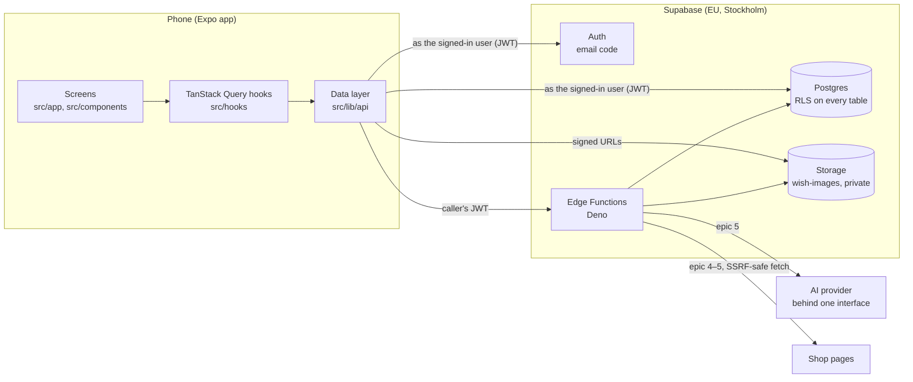
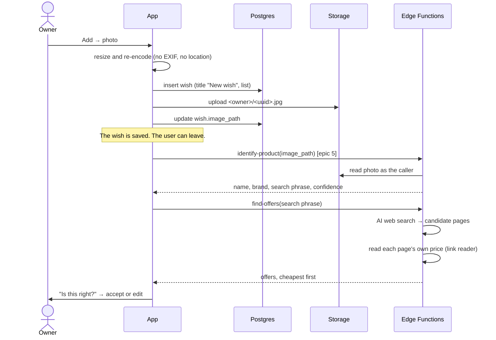
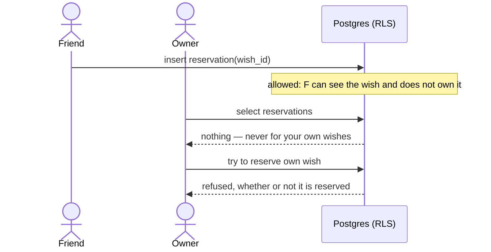

# Architecture

## The parts



- The app talks to Supabase **as the signed-in person**. What they may see and change is decided by RLS in Postgres, never by the app.
- Edge Functions exist for what the app cannot or must not do itself: deleting an account (service role, WISH-10), fetching a shop page (WISH-18), calling an AI provider with a secret key (WISH-22, WISH-23).
- The AI provider sits behind one interface (`supabase/functions/_shared/ai/`), chosen by secrets, so it can be swapped and compared (`docs/decisions/0003-ai-provider.md`).

## Folders

```
src/
  app/                 Expo Router screens (file-based routes)
  components/<feature>/  Screen parts, one component per file
  components/ui/       Building blocks that follow the theme
  contexts/            AuthContext
  hooks/               TanStack Query hooks
  lib/api/             Supabase calls, one file per table or function
  lib/supabase/        Client and generated types
  lib/constants.ts     Named constants
  locales/             sv.json, en.json
  theme/               Colours (light/dark), spacing, radii, type
supabase/
  migrations/          Schema, RLS, grants
  functions/<name>/    index.ts, handler.ts, handler.test.ts
  functions/_shared/   Shared code: CORS, the link reader, the AI layer
  tests/               local_stub.sql, rls_test.sql, run_local.sh
docs/                  Requirements, UI spec, decisions, data safety, AI eval, journal
eval/                  AI evaluation cases and product photos (epic 5)
```

## Main flows

### Add a wish with the camera (epics 2 and 5)



### Reserve a wish (epic 3)



### Invite (epic 1)

The inviter creates an invite (random code, 7 days) and shares `wishingwell://invite/<code>`. The invited person opens it, sees `preview_invite()` and accepts with `accept_invite()`, which makes the two contacts (once per pair) and marks the invite used. Nothing is shared by connecting: the owner shares lists and wishes afterwards.

### A list shared by link (epic 2)

The owner sets a list to "Anyone with the link"; the database makes the code (`list_links`, owner-only). The owner shares `wishingwell://l/<code>`. Whoever opens it signs in, and `open_list_link()` records them in `list_link_access` and returns the list. From then on `can_view_list` lets them see that list, and RLS does the rest as for a contact. "New link" (`regenerate_list_link()`) or leaving "Anyone with the link" deletes the old code and every recorded opening.

### Block (epic 1)

Inserting a row in `blocks` runs `blocks_cleanup` in the same transaction: the contact goes (and with it `connections_cleanup`), link access both ways, reservations both ways. `is_blocked()` is checked in every visibility function, in search, invites and links.

## Where the rules live

| Rule | Where | Proof |
|---|---|---|
| Who sees which list, wish, photo, reservation | `can_view_list` and `can_view_wish`, used by every RLS policy (`docs/decisions/0007-sharing-model.md`, `0009-links-blocks-and-search.md`) | `supabase/tests/rls_test.sql` |
| Who sees a profile | `can_see_profile`; being findable opens nothing | `rls_test.sql` checks 27, 32, 33 |
| Who owns a row | Triggers and column grants | `rls_test.sql` checks 16, 17, 22 |
| No secrets in the app | `EXPO_PUBLIC_*` only; secrets in Supabase and EAS | `/wish-review-pr` |
| Photos carry no location | Re-encoding on the phone | WISH-14 manual check |
| Prices are real | Read from the shop page | WISH-23 tests, `docs/ai-eval.md` |
